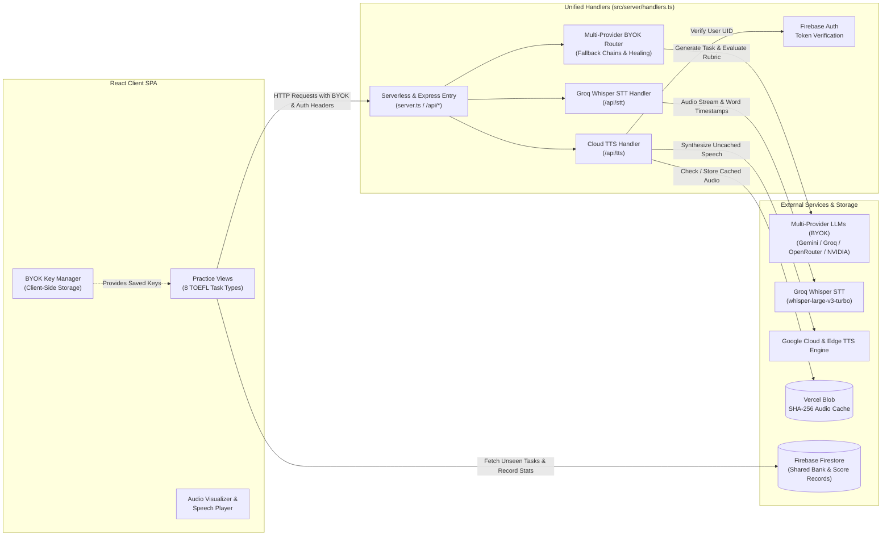

# TOEFL Prep Studio 🎓

> **Note**: *Personal TOEFL practice suite.*

An interactive, browser-based TOEFL practice suite designed around the latest test formats and ETS scoring standards (including the 1.0–6.0 Band Scale). Practice Reading, Listening, Speaking, and Writing tasks with authentic test timing, BYOK multi-provider LLM routing, Groq Whisper STT, Vercel Blob audio caching, and AI-powered diagnostic rubric evaluations.

---

## 🏗️ System Architecture



---

## 🌟 Key Features

- **Multi-Provider BYOK AI Router & Model Config**: Enter your API keys (Gemini, Groq, OpenRouter, NVIDIA, etc.) securely in Settings. The server routes generation, evaluation, and STT across optimal models with fallback chains, error classification, and retry-after / rate-limit tracking.
- **Speech-to-Text & Speaking Metrics**: Groq Whisper STT (`whisper-large-v3-turbo`) with word-level timestamps calculating WPM, filler words, pauses over 1 second, and longest pause. Chrome & Edge also support Web Speech fallback when keys are absent. (Brave requires an explicit Groq or Gemini key).
- **Text-to-Speech & Vercel Blob Caching**: Cloud TTS (`/api/tts`) authenticated via Firebase ID tokens with SHA-256 caching on Vercel Blob storage (`@vercel/blob`). Dialogues and Listen & Repeat synthesize multi-clip audio (`audioClips`).
- **Unified Handlers**: Express `server.ts` and Vercel serverless functions in `/api/*` share identical handlers (`src/server/handlers.ts`) for robust local development and production.
- **8 Authentic TOEFL iBT Task Types**: Complete Words, Reading Passages, Listening Dialogues & Lectures, Listen & Repeat, Speaking Interviews, Build Sentences, Write Emails, and Academic Discussions.

---

## 🚀 Quick Start

### 1. Prerequisites
- Node.js 18+ installed

### 2. Install Dependencies
```bash
npm install
```

### 3. Configure Environment Variables
Copy `.env.example` to `.env`:
```bash
cp .env.example .env
```
Configure your environment variables:
```env
GEMINI_API_KEY=""
GROQ_API_KEY=""
OPENROUTER_API_KEY=""
BLOB_READ_WRITE_TOKEN=""
FIREBASE_PROJECT_ID="your-firebase-project-id"

# Sentry Error Monitoring (Vercel Project Settings > Environment Variables)
# Set VITE_SENTRY_DSN for both 'Production' and 'Preview' environments in Vercel:
VITE_SENTRY_DSN="https://<public_key>@<org>.ingest.sentry.io/<project_id>"

# Optional server-side Sentry error reporting:
SENTRY_DSN_SERVER="https://<public_key>@<org>.ingest.sentry.io/<project_id>"
```

#### Sentry Configuration on Vercel:
To enable real-time error tracking across your deployment environments:
1. Go to your project on [Vercel Dashboard](https://vercel.com) > **Settings** > **Environment Variables**.
2. Add `VITE_SENTRY_DSN`:
   - Value: Your Sentry React project client DSN (`https://...@ingest.sentry.io/...`).
   - Environments: Check both **Production** and **Preview**.
3. (Optional) Add `SENTRY_DSN_SERVER` with your Node/server DSN to capture serverless route failures.
4. Redeploy or push a new commit to trigger a build with Sentry monitoring enabled.

### 4. Run Development Server
```bash
npm run dev
```
Open [http://localhost:3000](http://localhost:3000) in your browser. (Chrome and Edge provide optimal Web Speech fallback support; Brave requires valid BYOK keys).

### 5. Production Build
```bash
npm run build
npm start
```

---

## 🧪 Simulation Tests & CI
Run verification tests and simulations:
```bash
npm run test:sim
npm run lint
```

---

## 📚 Attribution & Licensing
- **Definitions**: WordNet 3.1, Princeton University (see `LICENSES/wordnet.txt`).
